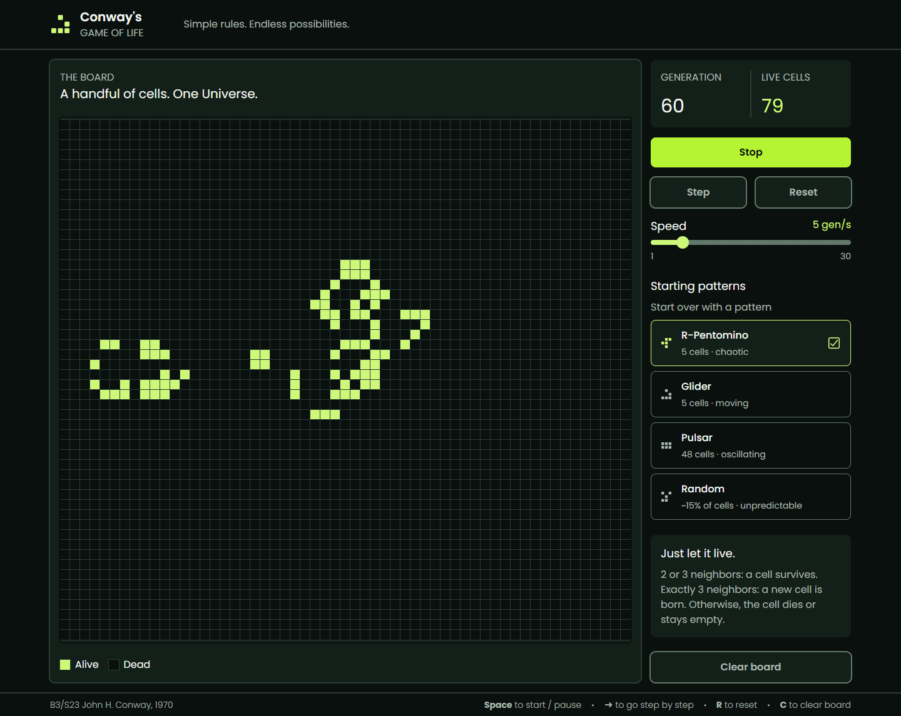

# Conway's Game of Life

A browser implementation of John H. Conway's cellular automaton (1970).

## How the simulation works

The board is a grid of cells, each either **alive** or **dead**. Every generation, all cells are updated at once based on their eight neighbors (rule B3/S23):

- A live cell with **2 or 3** live neighbors survives.
- A dead cell with **exactly 3** live neighbors is born.
- Every other cell dies or stays empty.

Cells outside the board count as dead.

Pick a starting pattern (R-Pentomino, Glider, Pulsar or Random), then start the simulation, advance it one generation at a time, or adjust the speed from 1 to 30 generations per second. The panel shows the current generation and the number of live cells.

### Keyboard shortcuts

| Key     | Action        |
| ------- | ------------- |
| `Space` | Start / pause |
| `→`     | Step forward  |
| `R`     | Reset         |
| `C`     | Clear board   |
